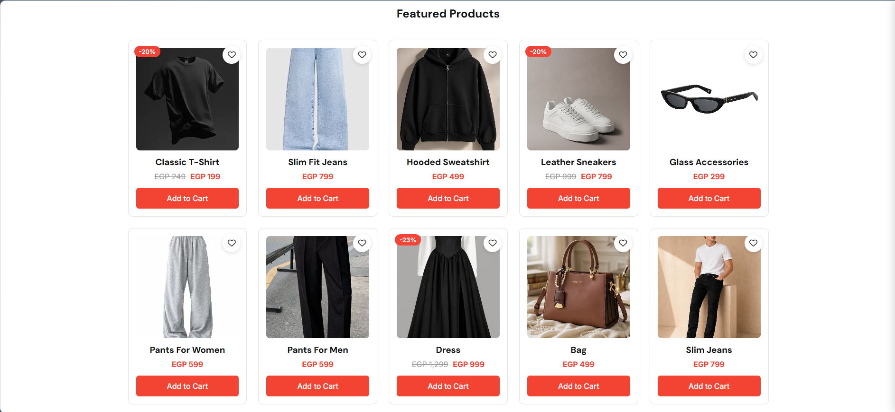
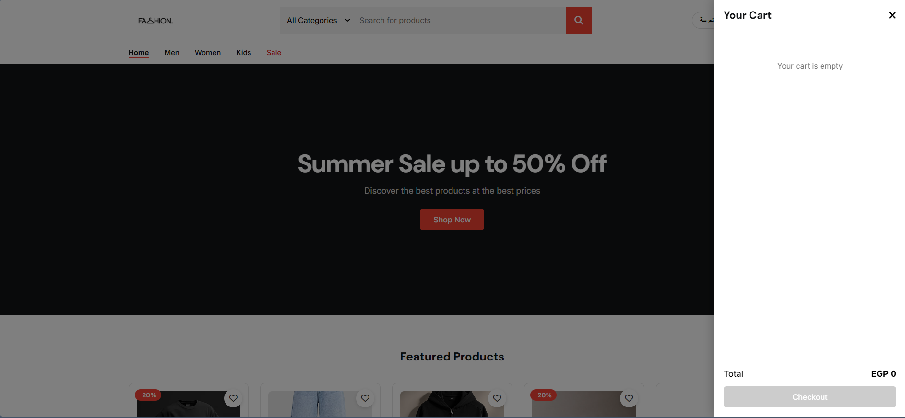

 # Fashion Store

A responsive fashion e-commerce website with a shopping cart, favourites, Arabic / English support, and WhatsApp checkout, built with HTML, CSS and vanilla JavaScript.

**Live demo:** [fashion-store-nine-beige.vercel.app](https://fashion-store-nine-beige.vercel.app)

## Screenshots





## Features

- **Product catalog** rendered from a JavaScript data array, with prices in EGP
- **Shopping cart** with + / − quantity controls, saved in the browser (`localStorage`) so it stays after a refresh
- **Cart drawer** that shows the items, subtotal, shipping fee and total
- **Live search and category filtering**
- **Navigation filters:** Men, Women, Kids and Sale pages built from product data
- **Sale prices** with the old price crossed out and a discount badge
- **Favourites** with a heart button on every product, a header counter and a favourites view, also saved in `localStorage`
- **WhatsApp checkout:** the customer enters name, phone, governorate, address and notes (with validation), and the order is sent as a ready-made WhatsApp message
- **Arabic / English** language switch with full RTL layout
- **Responsive design** for desktop, tablet and mobile

## Built With

- **HTML5**
- **CSS3** (Flexbox, Grid, media queries, RTL styles)
- **JavaScript (ES6+)**: DOM manipulation, event delegation, `localStorage`, array methods (`filter`, `find`, `reduce`), template literals
- **Font Awesome** for icons and **Google Fonts** (Cairo) for Arabic text
- **Git & GitHub** for version control
- **Vercel** for hosting

## Run It Locally

1. Download or clone this repository.
2. Open the folder in VS Code.
3. Open `index.html` with the **Live Server** extension (or directly in the browser).

## Project Structure

```
fashion-store/
├── index.html      # Page structure
├── style.css       # Styles (desktop, mobile, RTL)
├── script.js       # Products, cart, favourites, filters, language, checkout
├── img/            # Product images and logo
└── screenshots/    # Images used in this README
```

## Contact

- Email: [husseinmahmoud6620@gmail.com](mailto:husseinmahmoud6620@gmail.com)
- Phone: 01042219540
